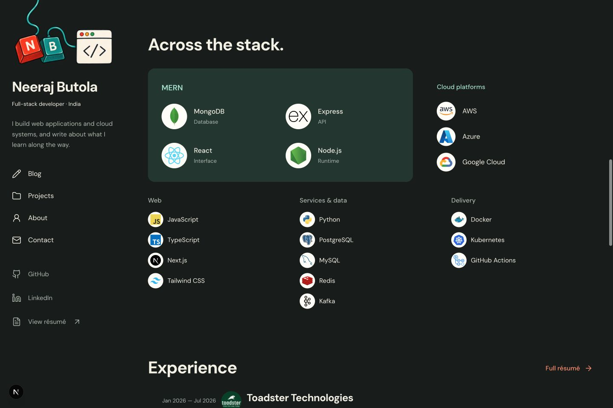
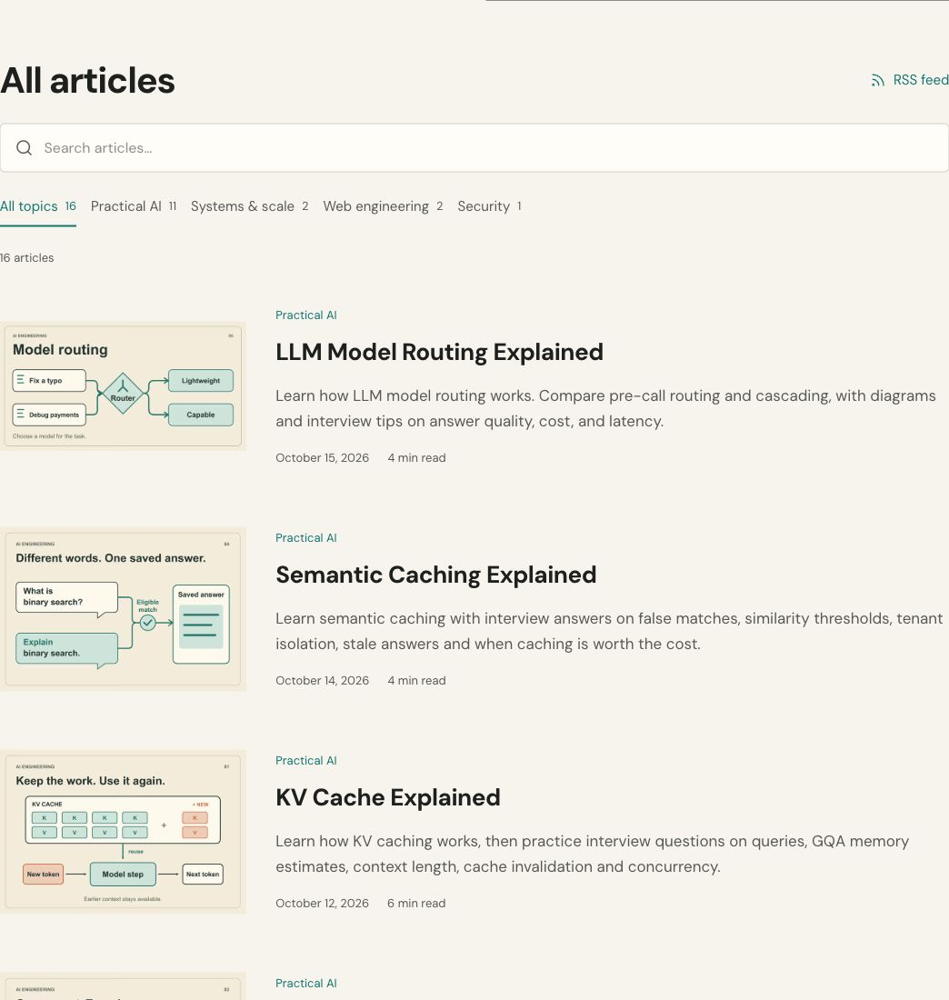
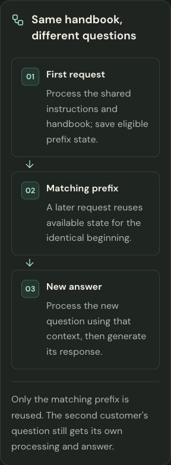
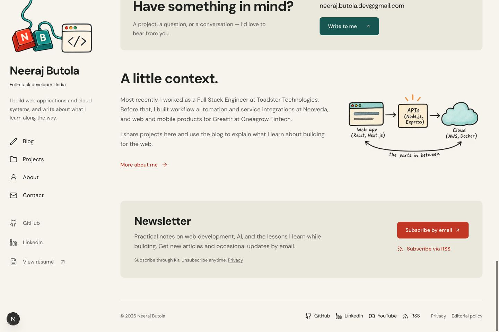

# Portfolio design review — 16 October 2026

The interface keeps the approved cream/forest notebook identity while reducing repeated labels, decorative borders and competing actions. Shared typography, spacing and focus styles now connect the portfolio, blog, contact page and résumé.

## Scope

- One blog action in the tall homepage hero; projects, toolkit, experience, contact and about follow it.
- Nineteen technology logos, including Python and all three requested cloud providers; circular company logos on the experience timeline.
- Consistent outline navigation icons, footer RSS and the existing newsletter flow.
- Quieter project and article layouts, contained code/table scrolling, readable responsive résumé content and clearer contact validation.
- Repository-local `frontend-design` and `web-design-guidelines` skills, with upstream source records.

The branch starts from `main` at `5a7bb08`. Its agent-readable content, canonical handling and indexing restrictions are preserved. No dependencies or environment configuration change.

## Verification

Fresh checks in the isolated PR worktree:

| Check | Result |
| --- | --- |
| `npm run lint` | Passed |
| `npm test` | 92 passed; zero failures |
| `npm run build` | Passed; 53 pages generated |
| `npm run test:editor-production` | Passed; editor routes return 404, all 16 public articles retain metadata parity, content and assets remain unchanged |
| Production route smoke check | 15 public, API, feed and Markdown routes returned 200; missing pages/articles returned 404 |
| `git diff --check` | Passed |

Design-preview browser checks covered 320, 390, 901 and 1440px layouts in light and dark themes, document overflow, project keyboard navigation, empty contact validation, skip-link focus and reduced motion. The screenshots below were captured during that design-preview review; the PR worktree then received the fresh automated checks above after integration with latest main.

Email and newsletter delivery were not submitted. This was not a full assistive-technology audit or performance benchmark.

## Screenshots

### Toolkit — desktop, dark

### Blog library — desktop, light

### Article diagram — 320px, dark

### Updates and footer — desktop, light

