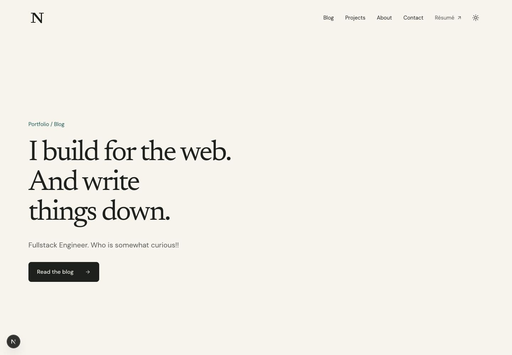
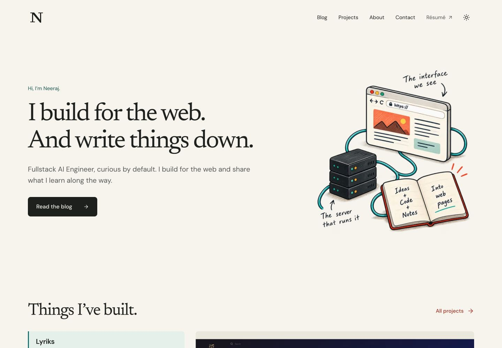
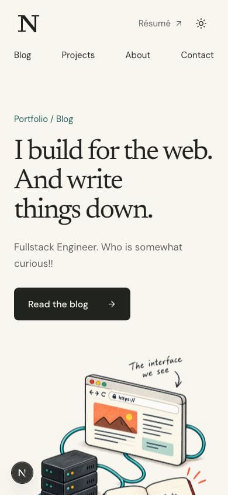
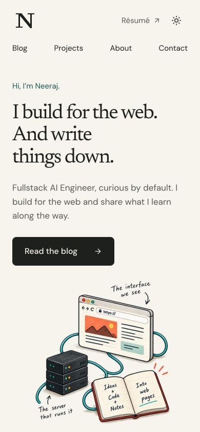
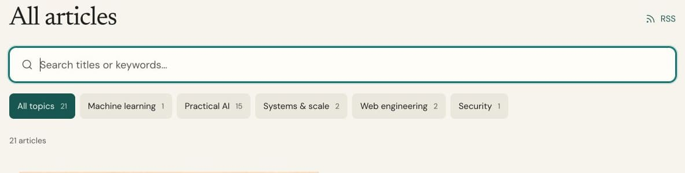

# Landing page and blog polish

Verified against the production build on 6 November 2026. Images are compressed JPEGs to keep review evidence small.

| View | Before | After |
| --- | --- | --- |
| Desktop, 1440 × 1000 |  |  |
| Mobile, 390 × 844 |  |  |

The hero uses responsive height, smaller artwork and type, and tighter section spacing. Profile copy now identifies Neeraj as a Fullstack AI Engineer. Project choices, toolkit headings, and contact typography follow the same spacing and hierarchy.

The blog removes its introductory sentence and visible featured range while retaining the screen-reader announcement and carousel controls. Search uses a green border and subtle green focus glow:

Validation: `npm run lint`, `npm run build`, `npm test` (94 passed), key route smoke checks, desktop/mobile overflow checks, and search/filter/clear-focus checks. Earlier UI verification also covered dark mode, reduced motion, project keyboard navigation, and widths from 320 to 1440 px.

SEO/performance measurements and proposed follow-up work are recorded in [the audit](../../research/2026-11-05-site-seo-performance-audit.md). This PR includes research; further image-loading and hosting changes remain follow-up work.
